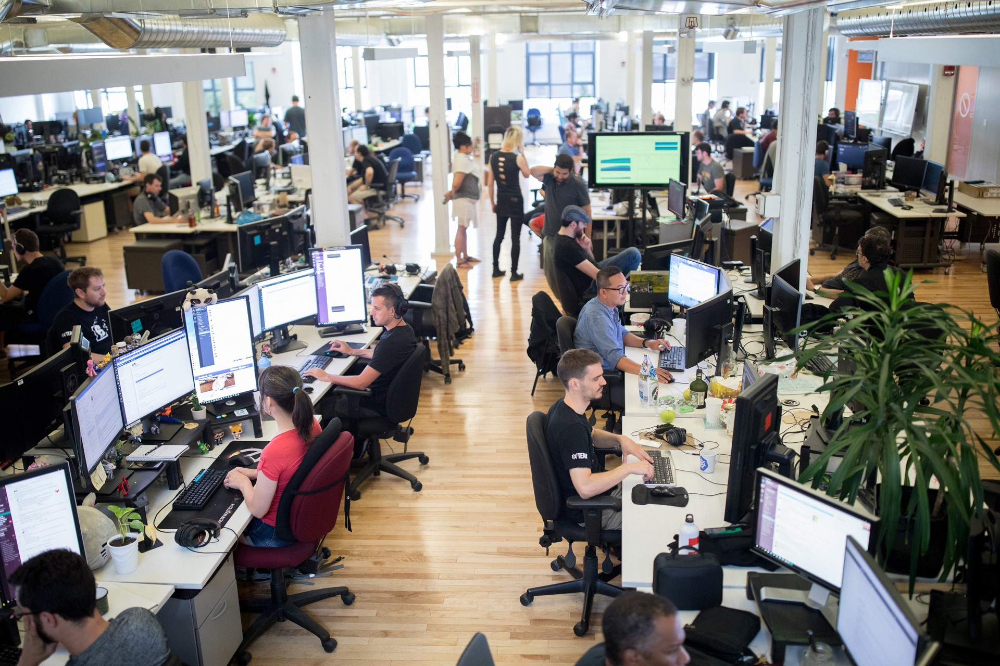
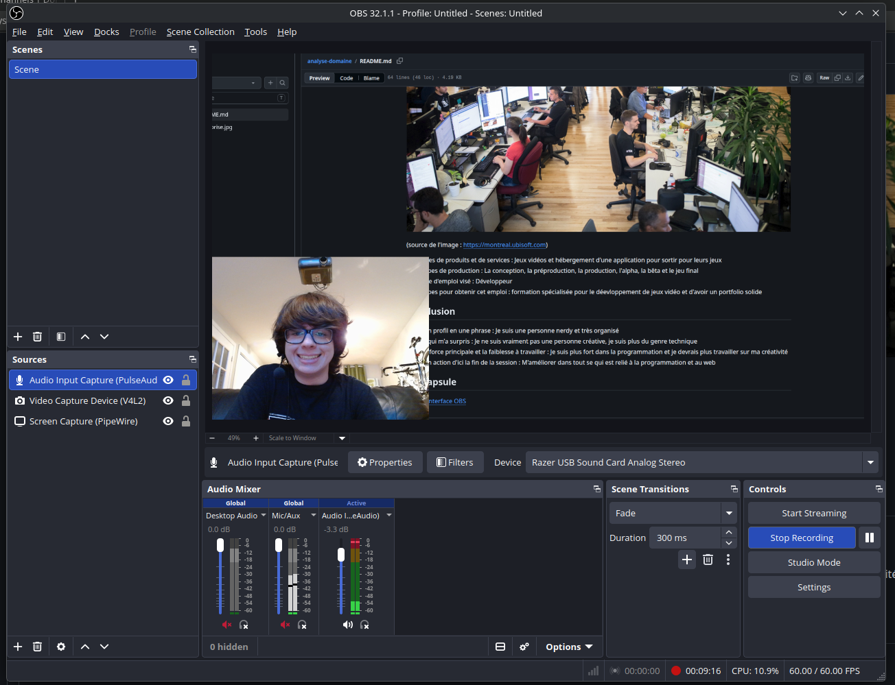

# Analyse du domaine — Étienne Ayotte

## Découverte de soi

- Mes forces : Je suis très persévérant durant des projets intenses et complexes
    - Exemple : Apprendre le noyau de Linux
- Mes faiblesses ou points à améliorer : J'ai une capacité d'attention très courte, je suis distrait facilement
    - Exemple : Travailler sur un projet et mon ami m'écris pour me demander de jouer avec lui
- Seul(e) ou en équipe : Seul
    - Pourquoi et exemple : Travailler seul pour moi a toujours été plus rapide et efficace
- Plutôt technique ou créatif : Je suis plutôt une personne technique, je préfère plus coder que de faire du design

## Exploration des domaines

| Domaine | Intérêt | Pourquoi |
|---|---|---|
| Graphisme | ... | ... |
| Vidéo et animation 2D | ... | ... |
| 3D | ... | ... |
| Web | ... | ... |
| Jeux vidéo | ... | ... |
| Développement logiciel | ... | ... |
| Installations et expériences immersives | ... | ... |

## Mes 2 domaines préférés

### Domaine 1 : ...

- Expérience : ...
- Logiciels et outils : ...
- Pourquoi il m'intéresse : ...
- Travailler dans ce domaine : ...

### Domaine 2 : ...

- Expérience : ...
- Logiciels et outils : ...
- Pourquoi il m'intéresse : ...
- Travailler dans ce domaine : ...

## Les caractéristiques de mon domaine préféré

- Types d'entreprises : ...
- Exemple d'entreprise : ...

(source de l'image : ...)

- Types de produits et de services : ...
- Étapes de production : ...
- Type d'emploi visé : ...
- Étapes pour obtenir cet emploi : ...

## Conclusion

- Mon profil en une phrase : ...
- Ce qui m'a surpris : ...
- Ma force principale et la faiblesse à travailler : ...
- Mon action d'ici la fin de la session : ...

## Ma capsule

